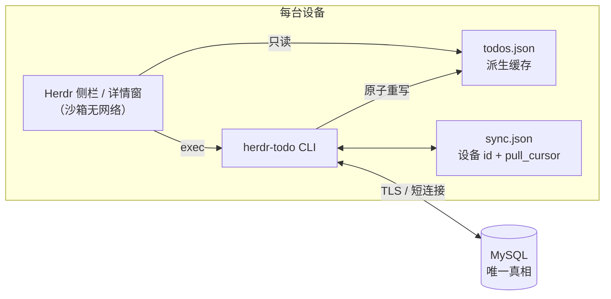
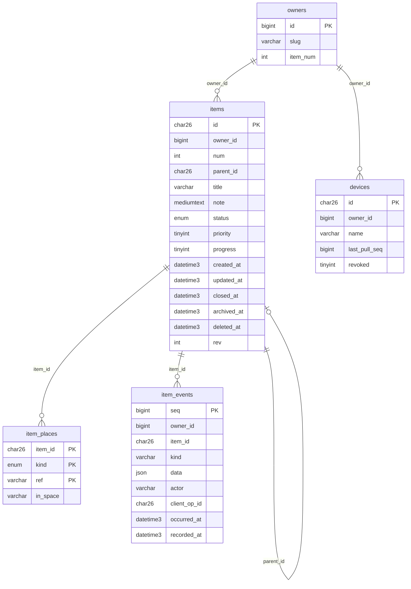
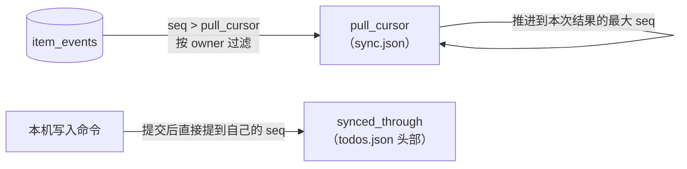

# Feature：待办云端存储与多端同步

**作者**：ethanxhzhao
**日期**：2026-11-23
**状态**：Delivered

## 摘要

待办账本目前是单机 JSON 文件，靠目录锁保证互斥，事项 id 在文件内自增。这套机制只在同一台机器上成立：两台机器各持一份账本，id 必然撞号，改动无法合并。本设计把唯一真相移到 MySQL，由 `herdr-todo` CLI 直连；本地 JSON 降级为派生缓存，面板继续只读它。

三处关键选择：

- **写入按 owner 串行**。每个写事务先锁住该 owner 的一行，再改事项、插事件。这让事件序号（同步游标）的分配顺序等于提交顺序，增量拉取因此不需要「延迟若干秒」的水位窗口——那个窗口是这类系统最常见、也最容易被误删的补丁。
- **时间线与变更流是同一张表**。每次写入恰好产生一条事件；单条事项的历史、按时间区间的检索、多端同步的增量，三者读的是同一份数据，不再各自维护一套时间。
- **id 由客户端生成（ULID），编号由服务端按 owner 连续分配**。前者让多端创建不会撞号，后者让人还能用 `#12` 指代一条待办。

代价：断网即不可用（本地缓存只读不写）；每台设备持有数据库口令。

## 1. 需求背景

### 1.1 问题与场景

使用者在多台机器上工作（macOS 本机、若干远程开发机），每台都装着 Herdr App 与这份待办侧栏。他想在任意一台机器上记录或推进待办，在另一台上看到结果。

当前实现的边界：

- 账本固定在 `$HOME/.local/share/herdr-todo/todos.json`，每台机器一份。
- 互斥靠 `mkdir` 锁目录加写入前比对原始字节（迁移前的 `src/io.js`），只在同一文件系统内成立。
- 事项 id 为 `t<序号>`，序号取自账本文件内的计数器（`src/core.js` 的 `addItem`）。
- Herdr mod 沙箱没有网络能力（宿主只提供 `exec` / `readTextFile` / `hc`），面板读不了远程数据。

因此「多端同步」不是加一个同步按钮能解决的：两份账本的 id 空间重叠，合并时无法区分「同一件事」与「两件不同的事」。

### 1.2 现状分析

现有模型里三处结构决定这次要动的地方：

| 现状 | 为什么在多端下不成立 |
|---|---|
| 整份账本的读-改-写 | 竞争窗口是整份文件；等价物的粒度必须降到单条事项 |
| id 文件内自增 | 两台机器各自从 `t1` 开始 |
| 时间线内嵌在事项对象里 | 无法按时间区间检索，也没有独立的并发控制点 |
| space/agent 关联是 JSON 数组 | 无法按关联建索引；并发改数组只能整组覆盖 |

面板侧不需要改渲染：它已经把账本当只读输入，所有写操作都通过 `herdr-todo` 命令完成（`mod/store.js` 的 `command()`）。这条既有约定正好是多端改造的支点——只需让缓存保持现有形状。

## 2. 目标与非目标

### 2.1 目标

- 待办数据以 MySQL 为唯一真相，任意设备的写入在其它设备的下一轮轮询内可见。
- 按 `owner` 分租户：一个 owner 是一个人，同一个人的多台设备共享同一份数据，不同 owner 之间互不可见。
- 面板的渲染、分组、拖拽与详情窗行为不变。
- 现有待办连同完整时间线与 space/agent 关联一次性迁入，内容不丢。
- 为「子待办」「手动进度」「区间时间线」预留数据结构；它们目前没有界面与命令入口。

目标冲突时的优先顺序：**数据不丢 > 多端一致（不静默覆盖、不漏拉） > 面板行为不变 > 编号可读 > 实现简洁**。

### 2.2 非目标

- **不支持离线写入。** 断网时只能读到上一次拉取的缓存，界面明示数据陈旧。离线队列会引入冲突解决策略，与「服务端为唯一真相」这一前提不相容。
- **不兼容旧 id。** 迁移后 `t12` 不再可寻址，也没有「旧 id → 新 id」的别名表：事项本身与全部历史都已导入，旧 id 的唯一价值就是指向它们，而这由新 id 承接。`show t12` 会报找不到并提示改用 ULID 或 `#12`。
- **不提供网关层。** CLI 直连数据库，口令存在于每台设备。加网关能收口凭据与迁移，但多一个需要运维与守活的服务。
- **不实现三项新功能的入口。** 建表时带上 `parent_id` 与 `progress` 两列、事件词表预留对应 `kind`，但界面不显示、CLI 不提供命令。
- **不做连接池。** CLI 是短进程，每条命令一个短连接。

## 3. 需求

### 3.1 功能性需求

**F1 多端一致性。** 任意设备完成的一次写入，其它设备在下一轮轮询（10 秒周期）内看到结果；不存在「两端各自成功、其中一条静默消失」的状态。

**F2 并发写入。** 两个设备同时改同一条事项时，两次改动都落盘，都在时间线上留痕，先后顺序由服务端在事务中确定。后到的写入基于前一次的结果判定，不会覆盖掉它。

**F3 重试安全。** 同一次用户操作因超时被重复提交，只产生一次效果、一条时间线记录。

**F4 租户隔离。** 任一命令只能读写自己 owner 的数据；换 owner 需要改配置——不提供命令行的身份覆盖，本机的缓存与游标只服务一个 identity。不同 owner 的编号空间、同步游标互不相干。

**F5 编号寻址。** 一条事项可用两种方式指代：全局唯一 id（ULID），或该 owner 内的人读编号 `#12`。`t12` 形式被拒绝并提示改用其中之一。

**F6 迁移完整。** 现有账本的每条事项、每条时间线记录、每个 space 与 agent 关联都进入新库，映射后可逐条核对。

**F7 面板行为不变。** 侧栏分组（未关联 / 各 space / Agents 栏 / space 已不存在）、拖拽改归属、详情窗的状态/优先级/标题/备注/归档操作、时间线展示，全部与迁移前一致。两个已批准的例外：超限输入（旧版对超长标题和备注静默截断后保存成功，现在 CLI 报错，见 §6.2）；以及 2026-11-24 用户要求「绑定 agent 的待办也按 `agent.space` 显示在侧栏对应 space 组、Agents 栏照旧显示、两视图各一次」——这推翻了迁移前「活 agent 事项侧栏不列」的显示口径，数据模型（space/agent 互斥、`in_space` 存关联当时 space）不变。

**F8 陈旧可见。** 拉取失败时面板显示「数据库不可达，显示的是 <时间> 的缓存」，不静默展示旧数据，也不清空列表。

### 3.2 非功能性需求

- **可见延迟**：轮询周期沿用现有侧栏的 10 秒，因此从其他设备写入到本机可见，通常是「当前周期剩余时间 + 一次 pull 耗时」，最坏接近两个周期（约 20 秒）。不承诺硬性上限，只承诺「同一轮询节奏内可见」，不引入额外的可见性延迟。
- **数据保留**：删除先记为墓碑；物理清除需同时满足「超过保留期」与「所有已知设备都已拉过该删除记录」。时间线事件默认永久保留。
- **单次写入的数据库交互**：一次事务，不超过 6 条语句，避免长事务拖住同 owner 的其它写入。
- **并发规模**：个人使用量级（单 owner 数十到数千条事项，写入间隔以秒计）。不为高并发设计。

### 3.3 约束

- MySQL 8.0.13 及以上（生成列、窗口函数、`utf8mb4_0900_ai_ci`）。
- **时区必须在连接与应用两侧同时固定**，缺一即错：会话执行 `SET SESSION time_zone = '+00:00'`，且驱动连接选项设 `timezone: 'Z'`。只设前者时，驱动仍按本机时区把无时区的 `DATETIME` 解成时间点，实测偏移 8 小时（28800000 ms）——所有事件时间会整体错位，且错得静默。读时间戳时按 UTC 解析字符串（或直接取 `UNIX_TIMESTAMP(col)*1000`），三种写法实测一致。
- 数据库账号只授予 `SELECT, INSERT, UPDATE, DELETE`，不含 DDL；建表由人工执行。
- 连接必须使用 TLS。

## 4. 设计方案

### 4.1 方案总览



写路径只有一条：面板调 CLI，CLI 在事务里改库，再重写缓存。读路径有两条：面板直接读缓存（快），以及面板的轮询先跑 `herdr-todo pull` 把别的设备的改动拉下来（新）。

### 4.2 接口与协议

#### CLI 表面

| 命令 | 变化 |
|---|---|
| `add` / `status` / `priority` / `title` / `note` / `link` / `unlink` / `move` / `set-spaces` / `agent` / `archive` / `unarchive` / `list` / `show` / `spaces` / `export` | 语义不变，底层改为事务写入 |
| `pull` | 新增。拉取增量、刷新缓存 |
| `devices` | 新增。列出设备及其最后拉取位置 |
| `import-json` | 新增。一次性导入旧账本 |
| `--file` | 删除 |

所有命令接受 `--json`，且 stdout 只放结果：`import-json --json` 的「已备份到…」「缓存留给下一次 pull」这类过程提示走 stderr，否则脚本拿到的是中文夹杂 JSON、无法解析。选项 `--by` 仍记录操作者，写入 `actor` 列。

退出码：`0` 成功、`1` 运行时错误、`2` 用法错误、**`3` 本地缓存竞争**、**`4` 数据库不可达**。`4` 与 `3` 分开，使面板能区分「稍后重试」与「网络/凭据问题」。

`3` 不再是旧版的「账本被另一个进程改写」：并发写入已由 owner 行锁串行化，同一行不会被两个事务交错改写。它现在只表示**本机这一份缓存**没写进去——等锁超 5 秒，或合并连续 8 次都撞上更新的版本。库里的写入已经提交，重试一次即可；不重试也不会丢数据。保留这个码而不是复用别的，是为了让仍按旧约定「遇 3 重试」的脚本继续正确。

#### 配置

`~/.config/herdr-todo/config.json`，权限 `0600`：

```json
{
  "host": "...", "port": 3306, "database": "herdr_todo",
  "user": "...", "password": "...",
  "owner": "<owner slug>",
  "ssl": { "rejectUnauthorized": true, "ca": "~/..." }
}
```

解析优先级：`--db <dsn>` > 环境变量 `HERDR_TODO_DSN` > 配置文件。三者只决定「连哪里」；owner 始终取自配置文件的 `owner` 字段，它标识「我是谁」，不从连接串推断。

`ssl` 省略时按 TLS 开启处理（等价于 `{"rejectUnauthorized": true}`）。写 `false` 表示明文连接，只用于本机回环测试库。写成布尔/字符串/数组、或 `ca` 指向读不到的文件，都属于配置错误（退出码 2），不能拖到驱动层才失败——驱动的 SSL 参数类型错误不带稳定错误码，会被当成普通运行时错误。

#### 数据模型



各列的含义（图中省略了唯一键，工蜂的 mermaid 版本不支持标注）：

- `owners.item_num` 是该 owner 的编号计数器，写事务里用它分配 `#num`。`slug` 唯一，是配置里写的 `owner`。
- `items.parent_id` 与 `items.progress` 目前只建列、没有写入路径；前者为子待办，后者为手动进度。`(owner_id, num)` 唯一。
- `items.closed_at` 记录最近一次进入 done / cancelled 的时间，重开时清空；`archived_at` 与 `deleted_at` 分别是「别在列表里烦我」与「删除」，两者不同（见 4.4 删除与墓碑）。
- `item_places.kind` 取 `space` 或 `agent`；`in_space` 只在 agent 关联时有值。
- `item_events.client_op_id` 是幂等键，唯一；`occurred_at` 是客户端时钟，`recorded_at` 是服务端时钟。
- `items.rev` 每次写入加一。它**不参与并发控制**——并发安全由 owner 行锁提供（见 4.4）。它的唯一用途是让面板能判断「手里这份快照是不是已经被别人改过」，目前没有任何代码读取它，因此不影响现有行为。

完整 DDL 见仓库 `db/schema.sql`，它是本设计的组成部分而非外部参考：上面列出的约束、生成列与索引在 DDL 里都要能一一对应。读 DDL 时以本节的行为承诺为准；两者冲突视为实现错误，须先改本节。

要点：

- `items.id` 为 ULID，客户端生成，`ascii_bin` 排序；`(owner_id, num)` 唯一。`items` 与 `item_events` 上的索引都以 `owner_id` 开头——这两张表按 owner 查询是主路径。`item_places` 不加 `owner_id`：它按 `item_id` 与 `(kind, ref)` 访问，而 `item_id` 已隐含 owner，租户过滤由联表或先取 `item_id` 完成；多加一列只会让同一事实存两份。
- `item_places` 用生成列 `agent_item = IF(kind='agent', item_id, NULL)` 加唯一键，使「一条事项最多一个 agent 关联」在结构上无法违反。多 space 关联不受影响。`in_space` 记录 agent 关联当时所在的 space，是侧栏按 space 归组该类事项的依据（agent 活着、搬家、关掉都用这个值，位置不跳）；agent 关闭后宿主不再报告它属于哪个 space，也只能靠这个值。
- `item_events.seq` 是全局 `AUTO_INCREMENT`，单调递增；`owner_id` 与 `item_id` 一并写入，使拉取可以 `WHERE owner_id = ? AND seq > ?` 走索引，不必关联 `items` 表。

#### 事件词表

`kind` 与 `data` 的对应关系：

| kind | data |
|---|---|
| `created` | `{"title","status","priority","from_parent":null}` |
| `status` | `{"from","to"}` |
| `priority` | `{"from","to"}` |
| `title` | `{"from","to"}` |
| `note` | `{"from_len","to_len"}`（正文留在 `items.note`，不塞进事件） |
| `spaces` | `{"from":[...],"to":[...]}` |
| `agent` | `{"from":null\|"地址","to":null\|"地址"}` |
| `archived` / `unarchived` | `{}` |
| `deleted` | `{}` |
| `parent` | `{"from":null\|"id","to":null\|"id"}`（预留） |
| `progress` | `{"from":null\|0-100,"to":0-100,"note":"..."}`（预留） |

未知 `kind` 必须被渲染层降级显示为 `kind` 原文，不得抛错——这是现有渲染器 `describeEntry` 的 `default` 分支已经在做的事，新增 `parent` / `progress` 因此在面板上安全。

`data` 的形状只在写入端校验（未知字段忽略、缺字段按 null），读取端不作第二次校验：写入口是唯一的，二次校验只会在格式演进时制造假失败。这与旧实现 `normalizeState` 对文件的严格校验不同——那里校验的是**可能被外部改坏的文件**，这里是**自己刚写的数据**。

### 4.3 组件设计

| 组件 | 职责 | 状态归属 |
|---|---|---|
| `src/rules.js` | 单条事项的规则：状态机、终态重开、归档与取消的区分、space/agent 互斥、长度校验。纯函数，输入「事项 + 关联 + 参数」，输出「新事项 + 新关联 + 事件列表」 | 无状态 |
| `src/store/mysql.js` | 事务、owner 行锁、编号分配、幂等、快照读取 | 数据库 |
| `src/cache.js` | 缓存派生与原子重写、写保护 | `todos.json`、`sync.json` |
| `src/core.js` | 只读侧：缓存校验、排序、分组、汇总 | 无状态 |
| `mod/store.js` | 面板侧：读缓存、调 CLI、触发 `pull` | 缓存 |

规则层与存储层分开的理由：规则要在无数据库的测试里逐步验证，而事务交错只能在真库上验证。两者混在一起时，任何一侧的失败都会把另一侧也拖进集成测试。

`item_events` 是唯一的事件来源；`items` 的当前值是事件的结果，不是并行的另一份记录。

### 4.4 关键机制

#### 写入串行化与游标正确性

所有写入在事务内第一件事是锁住 owner 行：

```sql
START TRANSACTION;
SELECT item_num FROM owners WHERE id = ? FOR UPDATE;   -- 串行化同一 owner 的写
-- 读目标事项（如需要）……
-- 应用规则，更新 items / item_places
INSERT INTO item_events (owner_id, item_id, ...) VALUES (...);  -- AUTO_INCREMENT 取号
COMMIT;                                                  -- 释放锁
```

这条锁同时兑现三件事：

1. 同一 owner 的并发写排在一条队列上，不会互相覆盖（对应 F2）。
2. 编号从 `owners.item_num` 递增，因此同一 owner 的 `#1 #2 #3` 连续——用全局 `AUTO_INCREMENT` 会让两个 owner 交替添加时跳成 1、3、5。
3. **同一 owner 内，事件序号的分配顺序等于提交顺序**。锁一直持有到 `COMMIT`，所以同 owner 的另一个写不可能在第一个事务提交前拿到更小的号。

因此**在同一 owner 内**，拉取只需取 `seq > cursor` 的行，不必等待时间窗口来规避「序号已分配、事务尚未提交」的乱序。

**但这条推理只对一个 owner 成立，不能推广到全局。** `seq` 是跨 owner 的全局 `AUTO_INCREMENT`，而 owner 行锁是每 owner 一把：owner A 的事务可能取到 `seq=96` 尚未提交，owner B 的事务取到 `seq=101` 并已提交。此时 B 的拉取若把游标推到全局 `MAX(seq)=101`，A 的 96 提交后就永远落在游标之下，**永久漏拉**。

所以有一条硬约束，实现必须照做：

> **游标只能推进到「本次实际取到并应用的最大 seq」，绝不能取全局 `MAX(seq)`。**

即拉取语句就是 `WHERE owner_id = ? AND seq > cursor ORDER BY seq LIMIT 500`，把结果里的最大 `seq` 作为新游标。因为已经按 owner 过滤且按 `seq` 升序，取到的最大值一定是本 owner 已提交的最大值，跨 owner 的空洞（别的 owner 占用的号）自然被跳过而不产生影响。**没有取到任何事件时游标不动**——否则会越过本 owner 尚未提交的取号，与该约束要防的失效同形。

代价与边界：同一 owner 的写入完全串行，长事务会阻塞其它写入——因此单次写入限定在几条语句内（见 3.2）。序号允许有空洞（回滚会消耗一个 `AUTO_INCREMENT` 值），游标直接跨过即可。

不另建 per-owner 事件计数器：`seq` 用全局 `AUTO_INCREMENT` 即可，因为每条查询都按 `owner_id` 过滤、游标取本次结果的最大值，「按 owner 有序」由行锁保证，而「全局连续」不是任何需求的承诺。若将来需要跨 owner 的全局有序流，届时再评估是否需要额外的计数器列。

#### 幂等

每次用户操作由客户端生成一个 ULID 作为 `client_op_id`，与事件一同写入，列上有唯一键。没有离线能力也一样需要它：网络超时并不等于服务端失败。

重试时插入命中重复键（`ER_DUP_ENTRY`），命令回滚事务，然后**按 `client_op_id` 读回那条事件及其 `item_id`，再读事项当前行**，据此组装返回值。返回的是**事项的当前状态**，不是「第一次调用时的快照」——两者之间若有别人写入，当前状态会不同，这是正确行为而非缺陷。不缓存「首次的响应摘要」：多一次只读查询，换掉一张需要清理的响应表。对 `add` 而言，事项 id 与 `num` 都在 `items` 行上，读回即可。

被回滚的操作不产生事件，因此重试后时间线上只有一条。

#### 两个游标



`sync.json` 的内含：`device_id`（首次运行生成的 ULID）、`owner`（这份本机状态属于谁）、`pull_cursor`、`last_pull_at`（上一次成功 pull 的本机时间；仅本机可见，不出现在 `devices` 命令输出里——那个命令展示的是服务端的 `last_pull_seq`）。它只存本机私有状态，删掉后可按上面的全量重建恢复。

**本机状态只属于一个 owner，换身份必须整份作废。** `pull_cursor` 与 `synced_through` 都是全局 `AUTO_INCREMENT` 的序号，两个租户的号段不可比：沿用上一个 owner 的游标去增量拉，会跨过新 owner 尚未拉取的事件（永久漏拉）；沿用它的缓存则会把对方的条目留在本租户的视图里。所以 `sync.json` 记下 `owner`，`pull` 发现与当前配置不一致时：作废旧缓存（备份后删除——它的 `synced_through` 与本 owner 的序号不可比，写保护会拒绝整体替换）、换一个新 `device_id`（旧 id 已登记在对方名下）、游标归零后重建。`sync.json` 没有 `owner` 字段（升级前写的）按「未知」处理，不触发重建。

**换身份只能改配置文件里的 `owner`。** 命令行 `--owner` 已被移除：它会拿单例的本机缓存与游标去服务另一个身份，上面那条失效路径无法在命令层面兜住。

两者语义不同，**不得合并**：

- `pull_cursor` 只由 `pull` 单调推进，只用于决定「下次从哪里拉」。它的含义是「本 owner 在 `seq <= pull_cursor` 范围内的事件已全部应用」。
- `synced_through` 是**缓存重写的单调保护戳**，含义是「这份缓存不认可任何 seq 小于它的写入」。它**不是**「缓存已包含 ≤ 该值的全部事件」——本机写入只更新自己那一条事项，缓存里其余事项可能仍是旧内容。写入命令提交后把它提到自己的 seq，但不碰 `pull_cursor`。

写路径更新缓存的方式必须固定为**只替换本次改动的事项（含其关联），其余事项原样保留**——与 `pull` 的逐条应用一致。若改成「每次写入都从库全量重派生缓存」，`synced_through` 就退化成与 `pull_cursor` 等价，两游标合并也不会丢数据，但每条命令都要读全量，代价与收益不成比例。

**缓存没有可用基线时（文件不存在，或内容为空/只有空白），任何写缓存的动作都不基于它写出新缓存**——写命令、一次性导入的缓存预热都一样。从空基线写出一份只含本次改动的缓存，会把「没有基线」这个信号抹掉：下一次 `pull` 会认为手里有一份可合并的缓存，于是走增量，而其余事项的事件早已在游标之下、再也不会被拉到。动作本身照常成功（真相已提交到库），缓存留给下一次 `pull` 做全量重建。

**这条判据在 `pull` 的每一批合并时同样要查。** 一次增量拉取可能连续跑好几批，存在性只在开头查一次是不够的：用户在第 2 批之前删掉缓存，那一批拿到的基线就是空状态，合并结果只含本批涉及的事项，其余事项与上面完全相同地永久失踪。所以 `pull` 的每次缓存合并都要求「文件必须已存在」，发现缺失就放弃增量、转入全量重建。

合并两者的后果很具体：本机写入把 `pull_cursor` 推到自己那个较大的 seq，就会跨过别的设备更早提交、本机尚未拉取的记录，那些改动永久丢失。

缓存重写前比对 `synced_through`：若本次要写入的值小于磁盘上现有的值，**这次写入作废、换到磁盘上那份较新的基线重做**（不是直接放弃，也不是覆盖）。否则一个慢速 `pull` 会把刚提交的写覆盖回旧内容。「读缓存 → 比对 `synced_through` → 合并 → 原子重命名」这一整段必须在同一把本地文件锁内完成，不能只锁比对与重命名：读在锁外时，读完之后另一进程可能已把缓存更新，本次合并会把它盖掉。

#### 拉取与缓存派生

一次 `pull`：

1. 取 `seq > pull_cursor` 的事件（按 owner 过滤），上限 500 条；取到满额则本次结束后继续下一批。
2. 收集其中出现的 `item_id`，读这些事项的当前行与关联行，以及每条事项最近 20 条事件。**读当前行不过滤 `deleted_at`**：墓碑行必须能读到，否则「本批里被删除的事项」无从判断该移除。若某事物在库里已物理清除（早于保留期回收），按「不在结果里」处理，同样从缓存移除。
3. 逐条应用：事项存在且未删除的，按 id 整体替换缓存中的对应项；`item_places` 折叠回 `spaces` 数组与 `agent` 对象；事项已删除或已不存在于库中的，从缓存移除该项。缓存中未被本批涉及的事项原样保留。
4. **先落盘缓存，成功后才推进 `pull_cursor`。** 两步的顺序不能颠倒：游标一旦前进就表示「这批事件已应用」，若此刻缓存没写成功，那批改动再也不会被拉第二次。

写保护与这一步的交错必须显式处理，否则会静默丢数据。场景：`pull_cursor=400`，本批读到 401–405；与此同时本机写入以 `seq=412` 提交，把缓存的 `synced_through` 提到 412（只替换了自己那条，401–405 尚未应用）。此时：

- **错误做法**：发现 `412 > 405` 就放弃写缓存，但仍按步骤 4 把 `pull_cursor` 推到 405 —— 401–405 此后永不重拉，其改动从本机缓存静默消失，直到那些事项恰好又被写一次。
- **正确做法**：写保护冲突时**重读当前缓存**，把本批 401–405 涉及的事项合并进这份较新的缓存，`synced_through` 取两者较大值（412）。同 id 冲突时以**缓存里那份较新的**为准，不以库中读到的为准——库中之读发生在冲突写提交之前，拿它覆盖会把本机刚写的改动短暂回退（下一轮 pull 会修回，但用户会看到一次闪回），落盘成功后再推进 `pull_cursor` 到 405。

也就是说，写保护不是「放弃这次 pull」，而是「换到更新的基线再应用一次」。放弃写入只能用于一种情形：重读后的缓存已经包含了本批的等价信息（即 `pull_cursor` 已不小于本批最大值）。

按 id 整体替换而非重放事件，使重复拉取同一段天然幂等。

**缓存文件本身不存在时同样走全量重建**：缓存是派生物，删掉它（或从未有过）意味着本机手里没有任何一份可合并的基线，此时按零游标做增量拉取只会把「游标之后的事件」合进空缓存，其余事项永远缺席——它们的事件早已在游标之下，不会再被拉到。

**「存在」不等于「有基线」。** 只有内容是一份完整 JSON 的快照才算数，哪怕它的 `items` 为空；文件存在但内容为空或只有空白（`> todos.json` 这类清空写法、编辑器重写中途被打断、恢复工具留下的 0 字节文件），与文件不存在等价，同样走全量重建。把它读成「合法的空快照」再合并，失效方式与上面完全相同：合并结果只留下本批涉及的事项。判据因此落在文件内容上，而不是「`exists()` 为真」或游标的相对大小上（后者会被「先清空再写一条」绕过——写入会把 `synced_through` 抬到本条事件的 seq）。

**`sync.json` 丢失或损坏时**：`pull_cursor` 归零，并**立即把归零后的值落盘**（重写 `sync.json`），再开始重建；这样重建中途失败或超过重试次数时，下次运行仍从 0 开始重建，而不是从一个已被删除的旧游标位置增量拉取。归零只在内存中生效是不行的。归零之后**不许把缓存当成空的再合并**——正确做法是走一次全量重建：在一致性快照内分页读完本 owner 全部未删除事项（含关联与最近 20 条事件），用结果**整体替换**缓存（不是合并），游标取快照开始时的 `MAX(seq)`（见下段）。整体替换而非合并，才能让「库里已不存在的事项」从缓存消失；若只做增量合并，游标归零后事件已清的旧条目会永远留在缓存里。

全量重建必须在一个**一致性快照**内完成（同一事务、`REPEATABLE READ`，或对全部读取使用同一只读事务）。原因：分页读的过程中若有并发提交，读到的行会跨多个时间点——游标却取重建结束时的最大 seq，那个事件对应的事项可能读的是旧值，于是它被当成「已应用」而永久落后。正确做法是：在快照**开始时**记录本 owner 的 `MAX(seq)` 作为游标上限，重建期间只读该快照；快照之后提交的事件留给下一次增量拉取。

**重建同样遵守「落盘成功才推进游标」。** 整体替换会与写保护相遇：重建快照的 `MAX(seq)=412`，而重建期间本机写入（seq=413）把缓存 `synced_through` 提到了 413，此时覆盖写会被判为「现有更较新」而放弃；若仍把游标设为 412，缓存里那些「早于 412 已删除、`deleted` 事件不会再被增量拉到」的条目就永远留着——正是全量重建存在的理由被抵消掉。

所以重建的写法是：写保护冲突时**重新取快照重做一次**（而不是放弃），直到整体替换成功；只有在替换成功后才推进游标。重做期间若有连续写入，允许重试若干次；超过重试次数则本次 pull 放弃且**不推进游标**，下次再补——宁可多拉一遍，也不让已删除的条目留在缓存里。

缓存格式：

```json
{ "v": 2, "synced_through": 412, "synced_at": 1794997750119, "items": [
  { "id": "01J...", "num": 12, "title": "...", "note": "...", "priority": "P1",
    "status": "doing", "spaces": ["sp..."], "created": 1794997750119,
    "updated": 1795081873942,
    "timeline": [ { "at": 1794997750119, "kind": "created", "from": null, "to": "todo", "by": "panel" } ] }
] }
```

`synced_at` 是缓存最后一次成功写入的时间（epoch 毫秒）；本机写入也会更新它。但 F8 要显示的是「**最后一次成功 pull** 的时间」，那是另一件事：本机写只让一条事项变新，不代表整份缓存新鲜。因此 `sync.json` 的 `last_pull_at` 才是 F8 的数据来源；`synced_at` 只用于诊断。缓存或 `sync.json` 缺失时，面板如实说「尚无缓存 / 尚未同步成功」，不编造时间。

`items[]` 的字段与迁移前逐字段相同（含可选的 `agent` 与 `archived`），外加 `num`——面板要在详情窗里显示 `#12` 让人能照着敲命令，`num` 必须进缓存。除此之外的字段形状不变，因此面板的渲染逻辑无需改动，只需在详情窗标题栏加一处编号显示。`timeline` 只保留最近 20 条：更早的历史仍在数据库里，`show` 从库里读完整时间线。

缓存正文含备注原文，因为面板要能显示它。这保留了面板读取接口 1 MiB 的上限——目前账本约 28 KB，离上限尚远；触顶时的处理是「终态事项的备注不进缓存」，不影响本设计的其它部分。

#### 删除与墓碑

删除写 `deleted_at` 并记一条 `deleted` 事件。拉取到该事件的一端把这条事项从缓存移除。物理清除需同时满足两个条件：`deleted_at` 早于保留期（180 天），且**同一 owner 下**所有未吊销设备的 `last_pull_seq` 都已越过该删除事件的序号。第二个条件防的是「一台设备离线两个月后回来，把已删事项重新拉进缓存」。

`devices` 表按 `(owner_id, id)` 归属，`id` 是设备首次运行时生成的 ULID，`revoked` 为 1 表示该设备已停用、不再计入 GC 的安全判定。`devices.id` 是全局主键，所以「同一个 id 换一个 owner 再用一次」不是同一台设备：登记时必须核对已有行的 owner，撞上别人的行就报错，绝不能 `ON DUPLICATE KEY UPDATE` 静默改写——那会让本 owner 永远没有登记行，GC 的 `minPulledSeq` 对着一个不存在的设备算。设备没有登记行时，`pull` 应当插入一行——否则 GC 看不见它，会在它仍持有某事项时清掉墓碑，导致该设备缓存永久保留已删条目。**插入与更新遵循同一条时序**：初值写 0，缓存落盘成功后再更新为本次的最大 `seq`。不要在建行时就写入「本次拉取的最大 seq」，那等于宣称一批尚未落盘的改动已被应用。

`last_pull_seq` 的推进时机是**缓存落盘成功之后**，不是拉取之后。若先推进再写缓存、而写缓存失败，GC 会误判该设备已拉过而清掉墓碑。它与 `pull_cursor` 取同一个值（本 owner 本次实际应用的最大 `seq`），但存在不同的表：一个是本机私有文件，一个是供 GC 判定的服务端状态。

长期不用的未吊销设备会使墓碑永不回收——这是有意的取舍：宁可留一条墓碑，也不要复活一条已删事项。设备的登记与吊销通过 `devices` 命令人工处理。

## 5. 备选方案

**延迟水位 + 事件 id 去重。** 不做 owner 行锁，靠 `recorded_at <= NOW() - Δ` 过滤掉可能尚未提交的记录，并重读 `[cursor - Δ, now - Δ]` 窗口去重。改动更小，但正确性依赖一个魔数 Δ，且它必须大于最慢事务的持续时间；事务变慢时窗口不再成立，而失效方式是静默漏拉。当前方案把这条依赖换成了结构性的锁，代价是同 owner 写入串行——在个人使用量级下这不是瓶颈。若实测发现锁带来的阻塞不可接受（例如某类操作需要长时间事务），再退回本方案，那时 `Δ` 的取值与重读窗口必须写进 spec。

**每个 owner 一个独立数据库。** 结构化隔离，客户端写错 SQL 也碰不到别人的数据。放弃的理由：建号与迁移要按 owner 循环，多一套运维脚本，且跨 owner 的聚合查询不再可能；而本项目的越权风险主要来自自身代码，单库加 `WHERE owner_id = ?` 已足够，配合只授予必要权限的账号。

**时间线单独一张表、变更流另用 binlog。** 放弃：两套时间语义要合并，两套游标要维护，而本项目的时间线本来就是要展示给人看的变更流。

## 6. 横切关注点

### 6.1 迁移

一次性脚本读旧账本写入新库：

- 每条事项分配新 ULID 与 `num`；`spaces` 数组展开为 `item_places` 行；`agent` 对象转为一行 `kind='agent'`，`in_space` 取原 `agent.space`。
- 每条时间线条目转为一行事件，`at` → `occurred_at`，`by` → `actor`，按原顺序分配序号。
- 序号从 1 开始连续分配，因此迁移后所有设备首次 `pull` 都会拿到完整历史。

迁移是单向的。旧 JSON 在迁移前备份（写入 `<源文件>.bak-<时间戳>`，因为最常见的用法就是拿默认缓存路径当源文件，而导入结束会把该路径重写成 v2 缓存），迁移后降级为缓存；第一次 `pull` 会重写它。

### 6.2 兼容与回滚

- **CLI 表面**：命令名与大多数选项不变；`--file` 删除；`t<数字>` 形式的 id 不再被接受。旧脚本若依赖这两点会失败——失败是显式的（退出码 2 或「找不到事项」），不会静默改错数据。
- **超长输入**：标题 200 字、备注 20000 字的上限照旧，但 CLI 由「静默截断」改为**报错**（退出码 1）。旧行为会让用户看到「已添加」而实际少了半句话，而时间线只记备注长度、正文不可恢复，所以这里接受一次显式失败换掉一次静默的数据丢失。面板里标题本来就在输入框前置拦下；备注编辑没有前置检查，超限时表现为此前「静默截断后保存成功」变为「保存失败、详情窗头部显示 CLI 的报错、已输入的草稿保留」。
- **缓存格式**：`v` 由 1 增至 2。旧版面板读 `v=2` 会在校验阶段报「不支持的数据版本」并显示错误行，而不是把缓存当成空账本覆盖——这是两者都可接受的最低要求。
- **回滚**：数据库是唯一真相，回滚到旧版 CLI 意味着旧版会试图读 `v=2` 的缓存并拒绝写入，数据仍在库里，不会损坏。要真正退回单机文件模式，需从库里导出。

### 6.3 并发与顺序

- 同一 owner 的写入全序由 owner 行锁保证。
- 不同 owner 的写入互不阻塞，其事件序号交错，但各自按 owner 过滤后仍严格有序。
- **`occurred_at` 的排序限制。** `occurred_at` 是客户端时钟，跨设备存在偏差。它只用于展示与「一段时间内」的检索；排序与游标一律用 `seq`。同一毫秒内发生的多条变更在旧实现里靠数组顺序区分（实测现有账本有 14 处同毫秒条目，是旧 `stamp()` 时钟单调化补丁的产物），迁到多端后改为按 `seq` 排序，否则同刻事件的先后会随读取顺序漂移。因此派生缓存的时间线条目必须带上 `seq`（面板只读缓存，不读库）；从旧账本导入的条目没有 `seq`，退回按 `at`。

## 7. 测试计划

| 承诺 | 检验方式 | 通过判据 |
|---|---|---|
| 规则语义与迁移前一致（F2、F7） | 纯函数单测，覆盖终态重开、归档与取消的区分、space/agent 互斥、备注只记长度 | 现有写侧断言逐条对应并通过 |
| **超长输入报错**（F2、F7） | 单测覆盖 create、title、note 三条入口的边界与越界；CLI 测试走一遍 `add` 的超长标题 | 边界值 200 / 20000 字通过；越界以退出码 1 失败、消息写明上限与实际长度，**没有任何内容落库**（不静默截断） |
| **`closed_at` 跟状态走**（F2） | 单测：完成 → 重开 → 归档 → 取消后重开 | 进入任何终态（done / cancelled）时写入时间戳，回到非终态时清回 `null`，不存在「已重开但仍带关闭时间」 |
| 并发不丢更新（F2） | 真库集成测试：两个连接交错修改同一条事项 | 两次改动都在时间线上，最终状态由顺序决定，无第二条被覆盖 |
| 重试安全（F3） | 真库集成测试：同一 `client_op_id` 提交两次 | 只有一条事件；第二次返回同一事项的当前状态 |
| 编号连续唯一（F5） | 真库集成测试：同一 owner 并发添加 10 条 | 编号为 1..10，无重复无跳号 |
| 增量拉取正确（F1） | 真库集成测试：两端交错写，各自 pull | 两端缓存最终一致；重复 pull 不再改变缓存 |
| **跨 owner 交错提交不漏拉**（F1、F4） | 真库集成测试：owner A 的事务取号后挂起不提交，owner B 事务取到更大号并提交，B 执行 pull | B 的 `pull_cursor` 只推进到 B 自己取到的最大 seq，**不等于**全局 `MAX(seq)`；A 随后提交，B 下次 pull 仍能拉到 A 的事件 |
| **两游标不可合并**（F1） | 单测：本机写入后检查 | `synced_through` 前进到该写的 seq，`pull_cursor` 不动；随后 pull 仍能拉到更低 seq 的他人事件 |
| 游标丢失后恢复 | 集成测试：删除 `sync.json` 后执行 pull；再测重建中途失败的分支 | 走全量重建并整体替换缓存；库中已不存在的事项从缓存消失；**归零后的游标已落盘**，重建失败或重试耗尽后重运行仍从 0 重建；**重建期间发生本机写入时**，重建会重做并最终成功替换，或放弃且不推进游标——不会出现「游标前进了但删除项仍在缓存里」 |
| **缓存不可用**（F1） | 集成测试：删掉缓存、保留 `sync.json`，分别测「直接 pull」、「先写一条再 pull」与「增量拉取途中删掉」；把缓存清成 0 字节再测「直接 pull」与「先写一条再 pull」；导入的缓存预热另测一次；缓存原语单测覆盖「缺失 / 0 字节 / 纯空白」与「合法空快照」的判据 | 各条路径都走全量重建；写命令、增量合并与导入预热都不创建或基于空的缓存；重建后全部事项回到缓存 |
| 缓存写保护 | 单测：模拟慢 pull 与更新的缓存 | 慢 pull 不把缓存回退，而是换到较新基线后合并落盘；`pull_cursor` 仅落盘成功后推进 |
| **写保护与游标推进的时序**（F1） | 单测：`pull_cursor=400` 读到 401–405，期间本机写入把 `synced_through` 提到 412 | 401–405 的改动最终出现在缓存里；`pull_cursor` 不早于缓存落盘推进；再次 pull 不再重复处理这批 |
| 墓碑（F1） | 真库集成测试：一端删除，另一端 pull；再测 GC 的两个前置条件 | 另一端缓存中该条被移除；保留期未满或任一未吊销设备 `last_pull_seq` 未越过删除事件时，行不被物理清除 |
| 租户隔离（F4） | 真库集成测试：第二个 owner 的存在不影响第一个 owner 的命令；同一台机器改配置换 owner 后 `pull`；同一 device id 被另一个 owner 登记 | 编号、游标、列表均只看自己 owner；换身份后本机状态整体重建（备份后删缓存、换 device id、游标从 0 起），对方的事项不残留；撞上别人的设备行时报错而非改写 |
| **时间线顺序**（§6.3） | 单测：同一事项三条事件，其中一条来自时钟慢 5 秒的设备；集成测试看缓存里的时间线条目 | 顺序按 `seq`，不随时钟偏差变化；缓存条目带 `seq`；导入的无 `seq` 条目退回按 `at` |
| **v1 旧账本在缓存路径上** | 单测 + CLI 测试：把 v1 账本放到默认缓存路径后跑 pull / 写命令 | pull 以专门错误码停下并提示先 `import-json`，文件字节不变；写命令提交成功但跳过缓存 |
| 编号寻址（F5） | CLI 测试：`t12` 被拒绝并提示、`#12` 与 ULID 均能寻址 | 三种输入的输出符合 F5 |
| 迁移完整（F6） | 导入脚本自检 | 条目数、每条的首末事件、关联数与旧账本逐项相等 |
| **`--json` 的 stdout 契约** | CLI 与导入测试：逐条对 stdout 做 `JSON.parse`，含 `import-json --dry-run --json` 与 `devices --revoke --json` | 每个命令的 stdout 只有一份可解析的 JSON；备份路径、缓存提示这类过程信息出现在 stderr |
| 面板行为不变（F7） | 现有侧栏与运行时测试在改造后的缓存样本上运行 | 全部通过；除 F7 的两个已批准例外（超限输入改为报错见 §6.2、2026-11-24 agent 待办的侧栏归组）外未删改既有断言，这两处不算回归 |
| 陈旧可见（F8） | 面板侧单测：`pull` 失败时返回原因与 `last_pull_at` | 界面显示「显示的是 <最后一次成功 pull 的时间> 的缓存」，不清空列表；该字段缺失时显示「尚未同步成功」 |

各项由哪些测试承担：纯函数层在 `tests/rules.test.js` / `tests/core.test.js`，缓存原语在 `tests/io.test.js`，真库集成在 `tests/store.test.js` / `tests/pull.test.js` / `tests/import.test.js`，命令表面在 `tests/cli.test.sh`，面板侧在 `tests/mod-runtime.test.js` / `tests/sidebar.test.js` / `tests/argv.test.js`。

已执行（2026-11-23，最终代码状态）：上表各行全部通过——`npm test` 与 `npm run test:db` 各 219 条、`tests/cli.test.sh` 35 组、五个 mod `herdr-app check` 通过（`mod` 与 `mod/spaces` 的 check 会实际调用一次 `hc`）。未执行：真实 Herdr App 内的 UI 级行为（只由 `check` 与面板单测覆盖）、云端实例的 TLS 往返（该实例当前不支持 SSL）、两台真机之间的轮询（用两个独立 store 与各自 `sync.json` 模拟）。

## 8. 风险与应对

- **同 owner 写入串行成为瓶颈。** 个人使用量级（写入间隔以秒计）下不成立；若将来出现批量导入之类需要长事务的操作，应把它拆成多条短事务，而不是放宽锁。
- **口令分散在各设备。** 缓解是只授予单库读写权限、强制 TLS、账号可随时吊销。接受了「直连」这个前提，就没有更彻底的办法；引入网关属于另一次交付。
- **缓存带上限。** 备注进缓存意味着面板读取接口的 1 MiB 上限仍然存在。超过时面板明确报错并说明原因，命令行不受影响。
- **`mysql2` 是首个运行时依赖。** 安装脚本必须能取到它，否则装出一个连不上库的 CLI 比装不上更糟——安装应在取不到依赖时报错退出。

## 9. 参考资料

- 现有实现：`src/core.js`（只读派生）、`src/rules.js`（写侧规则）、`src/store/mysql.js`（事务与数据库）、`src/cache.js`（原子写、锁、写保护）、`src/sync.js`（写入编排与 pull）、`src/cli.js`（命令表面）、`mod/store.js`（面板读写路径）。
- 参考模型：Todoist Sync API 的 `parent_id` / `child_order` / `uuid` / `temp_id` / `is_deleted` 与 `sync_token` 增量同步；Vikunja 的任务关系表与 `percent_done`；RFC 5545 的 `UID` / `SEQUENCE` / `PERCENT-COMPLETE` / `RELATED-TO;RELTYPE`。
